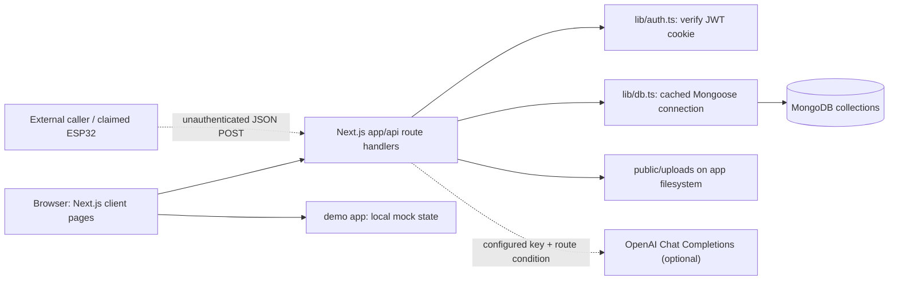
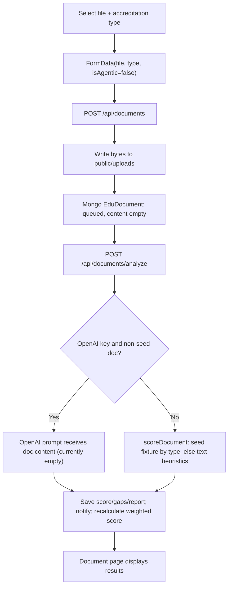
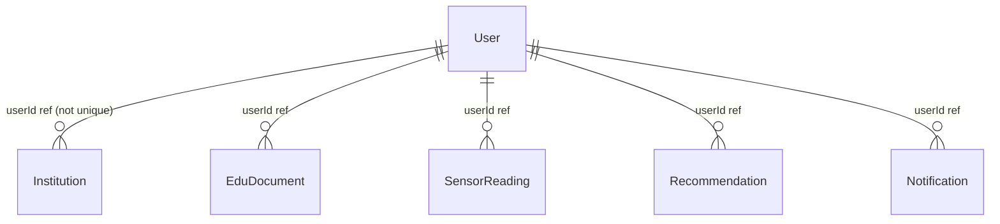

# EduTrace-ES Technical Documentation

## Audit scope and evidence labels

This document describes the repository as inspected, not the intended end-state in the PRD, technology-stack report, checklist, or implementation plan.

- **Verified** — directly visible in source, configuration, or checked-in documentation.
- **Inferred** — a conclusion drawn from the implementation, but not explicitly guaranteed by it.
- **Unclear** — the repository does not establish the behavior.
- **Not Implemented** — referenced or presented as a capability, but no working implementation was found.

The codebase contains two separate Next.js applications: `edutrace-web` and `demo`. The full application has API routes, Mongoose models, and optional OpenAI calls; the demo app is a separate mock-data frontend. There is no Python application, Streamlit app, SQL schema, or test suite in the inventoried source.

## A. Project overview

### What the code does

**Verified:** EduTrace-ES is a prototype web application for displaying and managing accreditation-readiness data. `edutrace-web` implements a Next.js App Router frontend and API routes for user registration/login, institution/document/sensor/recommendation/notification data, plus MongoDB persistence through Mongoose. Some document-analysis and recommendation paths can call OpenAI when `OPENAI_API_KEY` is configured. The `demo` app presents similar pages using in-memory hardcoded and randomly generated data.

The core implemented data model covers institutions, document metadata and scores, sensor readings, notifications, and recommendations. The system can produce a weighted readiness number from analyzed document scores; it does not demonstrate that this number predicts a real accreditation outcome.

### Problem and users

The product documents describe reducing manual accreditation-preparation effort and helping institutions track readiness. They identify colleges/universities, administrators, accreditation committees, and IQAC/quality-assurance staff as target users. These are **documented intentions**, not user research validated by code.

### Implemented versus planned

| Area | Status | Evidence-based description |
|---|---|---|
| Web UI | Verified | Public marketing pages and dashboard pages exist in both applications. |
| Accounts | Partial | Registration/login and JWT-cookie handling exist in `edutrace-web`; SSO and password reset do not have working backend flows. |
| MongoDB persistence | Verified, partial | Mongoose connects to MongoDB and has six schemas; numerous API routes read and write records. |
| Readiness score | Partial | Weighted average from a subset of document types; two weighted categories are always zero and the underlying document scores are heuristic, seeded, or generated. |
| Document upload | Partial | Uploads a file and stores metadata, but does not extract the file's contents before analysis. |
| OpenAI | Partial/optional | Chat Completions calls exist for document analysis, generation helper code, and recommendations; the analyzed uploaded content is currently empty. |
| Sensor ingest | Partial | HTTP routes accept a limited JSON payload and persist readings; no firmware, broker, WebSocket, or live hardware integration is included. |
| Analytics/reports | Partial | Derived metrics and charts are displayed; the full app can create client-side PDF/CSV exports. Department/KPI values are formula-generated rather than calculated from department data. |
| OCR, RAG, predictive ML | Not Implemented | Mentioned in product materials; no OCR engine, embeddings/vector store, retrieval flow, trained model, or evaluation code was found. |
| Demo app | Verified | Browser-only mock values, local state, canned recommendations, and simulated sensor refreshes; no `app/api` routes. |

### Maturity

**Assessment: partially implemented prototype.** Evidence includes seeded/demo data, mocked pages, absent tests, unsupported marketing claims, missing extraction/authorization paths, and disconnected integrations. Some backend primitives are real (MongoDB writes, JWT verification/signing, bcrypt hashing, optional OpenAI requests), but do not make the overall system production-ready.

## B. Technology stack

| Technology | Purpose and evidence | Classification / caveat |
|---|---|---|
| Node.js + npm | The two applications have independent `package.json` and lockfiles, scripts use Next.js. No Node engine version is pinned. | Runtime/toolchain; exact supported local version is not established by the repository. |
| Next.js 16.1.6 App Router | Page routing, layouts, and server route handlers under each `app/` directory. The full app's dev script binds `0.0.0.0`; the demo uses the default dev command. | Direct dependency in both projects. |
| React 19.2.3 / React DOM 19.2.3 | Client components, hooks, and rendering. | Direct dependency in both. |
| TypeScript 5 | `.ts`/`.tsx` source, strict type checking enabled by `tsconfig.json`. | Direct development dependency in both; `allowJs` is also enabled in the full app. |
| CSS Modules and global CSS | Page/component styling through `.module.css` and `app/globals.css`. | Built-in project styling; no Tailwind dependency is declared. |
| MongoDB + Mongoose 9.3.1 | `lib/db.ts` connects with `MONGODB_URI`; `models/*.ts` define schemas and API routes call Mongoose queries. | Direct dependency in `edutrace-web` only. No SQL engine, migrations, or database-init script exists. |
| `bcryptjs` 3.0.3 | Password hashing with cost factor 12 and login/password-change comparison. | Direct dependency in `edutrace-web`. |
| `jsonwebtoken` 9.0.3 | JWT creation and verification for the `token` cookie. | Direct dependency in `edutrace-web`. |
| OpenAI Node SDK 6.32.0 | `lib/agenticAI.ts` calls `gpt-4o-mini` Chat Completions for document analysis/generation and recommendation text. Calls are conditional in routes. | Optional at runtime; requires `OPENAI_API_KEY`. No model training or benchmark evaluation is present. |
| Recharts 3.8.0 | Client-side charts in scoring, analytics, dashboard, and sensor pages. | Direct dependency in both. |
| Lucide React 0.577.0 | UI icon components. | Direct dependency in both. |
| jsPDF 4.2.1 | Browser-generated PDF analytics reports in the full app. | Direct dependency in `edutrace-web`; exports use currently displayed/derived data. |
| `multer`, `@types/multer` | Present in the full app dependency manifest. | **Unused:** no source import/use found. Next route uses `req.formData()` instead. |
| `pdf-parse` | Present in the full app dependency manifest. | **Unused by application source:** uploaded PDF contents are not extracted. |
| Python / Streamlit / Pandas / NumPy | Not present in application source/manifests. | Not integrated. |
| PostgreSQL / InfluxDB / SQL | Proposed in planning docs only. | Not integrated. |
| MQTT / WebSockets / ESP32 firmware / cloud deployment | Described in documents or UI copy; no broker, firmware, WebSocket server, or deployment configuration found. | Not implemented in this repository. |
| OCR, Tesseract, AWS Textract, Google Vision, PaddleOCR | Listed as options in the technology-stack report/checklist. | Not declared or used by application source. |
| FAISS / Pinecone / Weaviate / RAG | Mentioned as planned approaches in docs and marketing pages. | No embeddings, vector database, or retrieval pipeline found. |
| Docker / CI/CD / automated tests | Proposed or expected in planning materials. | No Dockerfile, compose file, workflow, or test files/scripts were found in the repository inventory. |

Evidence: [edutrace-web/package.json](./edutrace-web/package.json), [demo/package.json](./demo/package.json), [edutrace-web/tsconfig.json](./edutrace-web/tsconfig.json), [edutrace-web/lib/db.ts](./edutrace-web/lib/db.ts), [edutrace-web/lib/agenticAI.ts](./edutrace-web/lib/agenticAI.ts).

## C. Repository structure

Generated `.next/` directories and `node_modules/` were excluded from the source inventory. The `backup/` directory contains generated/dependency directories, not a separate source implementation.

```text
.
├── EDUTRACE_TECHNICAL_DOCUMENTATION.md   # This audit
├── design choices for edutrace.txt       # Design reference links
├── edutrace_checklist.md                 # Long-term project checklist
├── implementation_plan.md                # Proposed website scope; not proof of implementation
├── edutrace_es_prd.pdf                   # Product requirements
├── edutrace_es_tech_stack_report.pdf     # Proposed stack and architecture
├── .vscode/
│   ├── launch.json                       # Chrome launch URL (port 8080)
│   └── settings.json                     # Live Server port 5501
├── edutrace-web/                         # Backend-oriented Next.js application
│   ├── app/
│   │   ├── (public)/                     # Home, about, features, pricing, contact
│   │   ├── (auth)/                       # Login, registration, reset-password UI
│   │   ├── (dashboard)/                  # Dashboard shell and dashboard pages
│   │   ├── api/                          # Auth, accreditation, analytics, docs,
│   │   │                                 # IoT, sensors, recommendations, settings, etc.
│   │   ├── globals.css, layout.tsx
│   │   └── page.module.css               # No matching root app/page.tsx
│   ├── components/                       # Shared navigation, sidebar, topbar, footer
│   ├── lib/
│   │   ├── db.ts, auth.ts, agenticAI.ts
│   │   └── documents/                    # Seed fixtures, scorer, static recommendations
│   ├── models/                           # User, Institution, EduDocument, SensorReading,
│   │                                     # Recommendation, Notification
│   ├── public/                           # Static SVGs; uploads are written here at runtime
│   ├── check_db.js ... check_db5.js       # Local database diagnostic scripts
│   ├── get_user_id.js                    # Local database diagnostic script
│   ├── package.json, package-lock.json
│   ├── next.config.ts, tsconfig.json
│   └── README.md
└── demo/                                 # Separate mock-only Next.js frontend
    ├── app/
    │   ├── (public)/, (auth)/, (dashboard)/
    │   ├── globals.css, layout.tsx, page.tsx
    ├── components/                       # Shared presentation components
    ├── lib/documents/                    # Static document fixtures/rule-based scorer
    ├── package.json, package-lock.json
    └── README.md
```

### Important modules

- `edutrace-web/app/api/**/route.ts`: Next.js route handlers form the backend API.
- `edutrace-web/lib/db.ts`: cached Mongoose connection.
- `edutrace-web/lib/auth.ts`: JWT-cookie decoding helper and 401 response helper.
- `edutrace-web/lib/agenticAI.ts`: optional OpenAI prompts and result parsing.
- `edutrace-web/lib/documents/`: prewritten sample documents and rule-based scoring.
- `edutrace-web/models/`: persistence schemas and TypeScript interfaces.
- `edutrace-web/app/(dashboard)/dashboard/**/page.tsx`: client-rendered feature pages.
- `demo/`: separate UI-only implementation; it does not proxy to the full app's APIs.
- `check_db*.js` and `get_user_id.js`: manual scripts that connect to a local MongoDB and print database diagnostics. They are not npm scripts or application routes.

The workspace also contains diagnostic-looking files such as `debug.json`, `latest.json`, `sensors_debug.json`, `users_list.json`, `userid.txt`, and `debug.txt` under `edutrace-web/`. Their contents were not copied into this document; treat them as local artifacts and verify/redact them before sharing the repository.

## D. Architecture and component relationships

### Runtime architecture

The full app is a single Next.js project: browser components call same-origin route handlers; route handlers verify cookies (where implemented), connect to MongoDB, and operate on Mongoose models. Some document/recommendation paths optionally call OpenAI. Uploaded files are written to the app's `public/uploads` directory. There is no separate Python/FastAPI service or standalone backend process.



The diagram distinguishes the implemented HTTP ingestion route from an actual device integration: the repository contains no firmware, MQTT broker, WebSocket server, or proof of a physical sensor connection. The `demo` app is isolated from the full app's API/database.

### Startup and failure paths

1. Next.js loads the project entry (`npm run dev`, `build`, or `start`).
2. The dashboard client layout posts to `/api/seed` on mount; that endpoint requires a valid JWT and seeds synthetic data only when no documents exist. The client suppresses seed-request errors with `.catch(() => {})`.
3. API routes that call `connectDB()` fail if `MONGODB_URI` is absent or MongoDB cannot be reached. `lib/db.ts` explicitly throws when the URI is absent.
4. Protected APIs call `getAuthUser`; missing/invalid JWTs become a 401. This protection is inconsistent: accreditation GET and documents GET contain a fixed mock user instead of checking the cookie, while IoT ingest does not use JWT authentication.
5. Some route handlers return raw exception messages; others do not catch route/database errors. Client pages often parse JSON without checking `response.ok`.

Evidence: [edutrace-web/app/(dashboard)/layout.tsx](./edutrace-web/app/(dashboard)/layout.tsx) lines 7-11; [edutrace-web/app/api/seed/route.ts](./edutrace-web/app/api/seed/route.ts) lines 194-207; [edutrace-web/lib/db.ts](./edutrace-web/lib/db.ts) lines 3-16; [edutrace-web/lib/auth.ts](./edutrace-web/lib/auth.ts) lines 11-22.

## E. End-to-end data flow

### Document upload and analysis (full app)

1. **Input:** a user selects or drops a file in `app/(dashboard)/dashboard/documents/page.tsx`; the selected type and file are added to `FormData`.
2. **Upload:** `POST /api/documents` requires a JWT, reads the multipart form, creates a timestamp/randomized filename, writes the full byte buffer under `public/uploads`, and inserts an `EduDocument` record with `status: 'queued'`.
3. **Content:** the document record explicitly stores `content: ''`; there is no PDF/DOCX/XLSX parsing or OCR call in the upload flow.
4. **Analysis:** the page sends the record ID to `POST /api/documents/analyze`. The handler loads a record scoped by `userId`, sets `processing`, then:
   - calls OpenAI `analyzeDocument` only if a real API key is configured and `isAgentic` is false; or
   - calls `scoreDocument(type, content)` otherwise.
5. **Scoring:** `scoreDocument` returns the first prewritten seed document's score/gaps/report whenever that type has a fixture. Otherwise it awards fixed points for word count, numbers, percentages, and a table-like marker. Since uploaded `content` is empty, the real file's content does not affect either branch.
6. **Persistence and notifications:** score, gaps, and report are saved to MongoDB; a notification is created; analyzed documents are averaged by type and multiplied by fixed weights to update `Institution.overallScore`.
7. **Output:** the browser shows status, score, gaps, and the stored report. The download API requires authentication, but uploaded files are also placed below `public/` and receive a predictable public URL shape, so the static file path bypasses that API authorization.



### Analytics export and supplied CSV

`GET /api/analytics` builds six department scores as offsets from the institution's `overallScore` (default 70), and builds six KPI points from fixed month names and arithmetic increments. It also calculates statistics from analyzed documents. In the browser, `analytics/page.tsx` derives research as `round(score * 0.9)`, infrastructure as `round(score * 1.05)` capped at 100, student count as `500 + score * 10`, and status from score thresholds; the “Generate Report” button creates a downloadable CSV in the browser.

The separately supplied six-row CSV has the same six output columns and values produced by these formulas when the base score is 74 (as seeded in `api/seed`). It is consistent with a generated export; the application does not load that external CSV as input.

## F. Feature-by-feature implementation

| Feature | User-facing behavior and code | Actual processing / status |
|---|---|---|
| Public home/about/features/pricing/contact | `app/(public)/**` in both apps; `PublicNav` and `Footer` provide shared navigation. | Mostly static React content. Home stats (“94% prediction accuracy”, “200+ institutions”) and claims about RAG/OCR/IoT are literals, not measured output. Contact form only changes local `sent` state. |
| Login and registration | `app/(auth)/login/page.tsx`, `register/page.tsx`; `/api/auth/login` and `/api/auth/register`. | Real full-app account creation/login: MongoDB lookup/create, bcrypt hash/compare, JWT cookie. Registration UI is three steps; role/SSO are not backed by routes or authorization policy. Demo login redirects after a timeout without checking credentials. |
| Password reset | `reset-password/page.tsx`. | **Not implemented:** no reset API, token, email sender, or password-reset persistence. UI changes local state only. |
| Dashboard overview | `dashboard/page.tsx` calls accreditation, notification, and analytics APIs; `demo` uses static/random data. | Full app displays stored institution parameters and document stats, but the accreditation GET endpoint currently uses a mock user. Trend points and several KPI change labels are hardcoded. |
| Accreditations/scoring | `/api/accreditation` and `dashboard/scoring/page.tsx`. | Fixed weights: IIQA 15%, SSR 25%, DVV 20%, research 15%, innovation 10%, SDG 5%, satisfaction 5%, bibliometric 5%. Analyzed docs are averaged by type. `innovation` and `sdg` are always zero in recalculation; Infrastructure docs are not mapped. Historical chart values and projected grade thresholds are UI-side constants/heuristics, not an external accreditation formula. |
| Documents | `dashboard/documents/page.tsx`; `/api/documents`, `/analyze`, `/generate`, `/download`; `lib/documents/*`. | Upload stores file and metadata only; no extraction. Analysis uses canned fixtures or shallow text heuristics, with optional OpenAI call. `/api/documents/generate` creates stored fixture documents; it does not call `generateDocumentContent`. Report viewing shows persisted fields. |
| AI/document analysis | `lib/agenticAI.ts`. | One OpenAI chat call is implemented for analysis (up to 2,000 characters), and another helper generates plausible sample content. No factual validation, rubric data, evidence citations, ground-truth evaluation, or audit trail. The content-generation helper is not called by current application source. |
| Sensors | `dashboard/sensors/page.tsx`; `/api/sensors`; `/api/iot/ingest`. | Full app requests sensor data every 5 seconds; an empty database is seeded with simulated defaults plus random variation. Sensor API can store readings and calculate simple thresholds. Ingest maps a few request properties to predetermined nodes. The demo app creates random values client-side every 30 seconds. |
| Notifications | `/api/notifications` and notification page. | Authenticated GET/PATCH/DELETE for a user's notifications in the full app. Demo page uses canned items and local state. |
| Recommendations | `/api/recommendations`, `lib/documents/recommendations.ts`, `lib/agenticAI.ts`. | With a configured OpenAI key it calls recommendation generation using institution parameters and document gaps; otherwise it stores static recommendations. Static recommendation narratives include specific unsourced institutional statistics. It does not retrieve sensor readings in the route despite the UI claim. |
| Analytics/reports | `/api/analytics`, `dashboard/analytics/page.tsx`. | Department data is derived from one institution score, not department records. KPI trends are formula-generated. Full app has jsPDF text exports and a generated CSV download; demo export buttons have no handlers. |
| Settings | `dashboard/settings/page.tsx`, `/api/settings`. | Full app reads/saves name/profile/institution/password. Role field, photo, and sensor configuration controls are UI-only; the demo save simply simulates success. |
| Help | `dashboard/help/page.tsx`. | Static FAQs, placeholder search, `#` guide links, and inactive chat/docs buttons. FAQ claims about OCR, timing, exports, and supported standards are not substantiated by implementation. |
| Seed/demo data | `/api/seed`; static fixture modules. | Full app creates synthetic records: five departments, 10 generated student records per department, randomized marks/faculty attributes, fixture docs, six sensor readings, static recommendations, and an institution summary. These are sample data, not verified institutional records. |

## G. Python/TypeScript concepts used

### Python concepts

**Not applicable to the application source.** No Python source, notebook, Python dependency manifest, Pandas/NumPy code, or Streamlit code was found. Do not describe this project as a Python application in an interview.

### TypeScript/React concepts

The actual source uses modules/imports, typed function parameters and return values, interfaces, arrays/objects, array methods (`map`, `filter`, `reduce`), regular expressions, async/await, exceptions, React client components, state, effects, and JSX. Several pages use `any`, particularly for API responses; the model layer is more explicitly typed.

#### Example 1: rule-based score

Excerpt from `edutrace-web/lib/documents/index.ts` (lines 20-38):

```ts
const wordCount = content.split(' ').length;
const hasNumbers = /\d+/.test(content);
const hasPercentages = /%/.test(content);
const hasTables = /\|/.test(content) || /table/i.test(content);

let score = 50;
if (wordCount > 500) score += 10;
if (wordCount > 1000) score += 10;
if (hasNumbers) score += 10;
if (hasPercentages) score += 5;
if (hasTables) score += 5;
score = Math.min(95, score);
```

- `split(' ')` counts tokens separated by literal spaces; it is not a robust whitespace/tokenizer implementation.
- Regular expressions reduce content to three yes/no features: any digit, `%`, and a pipe or the word “table”.
- `score` starts at 50 and receives fixed bonuses. The maximum is clamped at 95.
- No benchmark or domain-specific rubric is loaded. Blank uploaded content still has a `split(' ')` length of one and therefore yields the baseline score/gaps in this fallback.

#### Example 2: weighted score

Excerpt from `edutrace-web/app/api/accreditation/route.ts` (lines 7 and 59-66):

```ts
const WEIGHTS = { iiqa: 0.15, ssr: 0.25, dvv: 0.20, research: 0.15, innovation: 0.10, sdg: 0.05, studentSatisfaction: 0.05, bibliometric: 0.05 };

const overallScore = Math.round(
  Object.entries(WEIGHTS).reduce((sum, [key, weight]) => {
    return sum + (parameters[key as keyof typeof parameters] || 0) * weight;
  }, 0)
);
```

The calculation multiplies each parameter by its weight, adds the values, and rounds to an integer. Missing/zero values contribute zero. A parallel implementation is duplicated in `documents/analyze/route.ts`; maintaining both risks drift.

#### Example 3: React state and polling

Excerpt from `edutrace-web/app/(dashboard)/dashboard/sensors/page.tsx` (lines 22-40):

```tsx
const [sensors, setSensors] = useState<any[]>([]);
...
useEffect(() => {
  load();
  const interval = setInterval(load, 5000);
  return () => clearInterval(interval);
}, []);
```

`useState` stores the client-side sensor list; `useEffect` performs the initial load and starts polling after mount; the returned cleanup clears the interval when the page unmounts. This is HTTP polling, not a WebSocket stream or proof of live hardware.

#### Example 4: Mongoose interface and schema

Excerpt from `edutrace-web/models/User.ts` (lines 3-24):

```ts
export interface IUser extends Document {
  institutionName: string;
  email: string;
  password: string;
}

const UserSchema = new Schema<IUser>({
  institutionName: { type: String, required: true },
  email: { type: String, required: true, unique: true, lowercase: true },
  password: { type: String, required: true },
});
```

The TypeScript interface describes the application-facing model type; the Mongoose schema applies runtime persistence rules. `unique: true` requests a unique database index; the registration code also checks for an existing email, but no explicit index migration/init code is provided.

## H. Database and SQL analysis

### Database mechanism

**Verified:** MongoDB through Mongoose. `connectDB()` checks `MONGODB_URI`, reuses a connection/promise cached on `global`, and calls `mongoose.connect`. There is no SQL, ORM-to-SQL layer, migration directory, or schema-init script. Collections are managed through Mongoose models and ordinary query/aggregate methods.

### Collections and relationships

| Model / inferred collection | Fields and constraints established by schema | Notes |
|---|---|---|
| `User` / `users` | `institutionName`, `institutionType`, `accreditationTarget`, `firstName`, `lastName`, `email` (required, unique, lowercase), `password` (required), `plan` (default Starter), `createdAt`. | Passwords are bcrypt-hashed in registration/password-change routes. |
| `Institution` / `institutions` | `userId` ObjectId ref to `User`; name/type/accreditation target/code; overall score/date; eight numeric parameters; nested department/student/faculty, research, infrastructure, survey objects. Timestamps enabled. | `userId` is required but not unique; code uses `findOne`/upsert, which does not enforce one institution per user. |
| `EduDocument` / `edudocuments` | `userId` ref; name; type enum (`SSR`, `IIQA`, `DVV`, `Research`, `Survey`, `Bibliometric`, `Infrastructure`); status enum; size/content/score/gaps/report/isAgentic; file metadata/path. Timestamps enabled. | Stores content and an absolute file path; upload currently stores empty content. |
| `SensorReading` / `sensorreadings` | `userId` ref; nodeId/location; type enum; value/unit/status enum/timestamp. | No explicit timestamps option; timestamp defaults to now. |
| `Recommendation` / `recommendations` | `userId` ref; priority enum; title/why/actions/impact/category/color/resolved. Timestamps enabled. | Full route replaces unresolved records before inserting regenerated items. |
| `Notification` / `notifications` | `userId` ref; type enum; title/body/read. Timestamps enabled. | GET is capped at 50; PATCH marks one/all read; DELETE removes read records. |

The relationship intent is one user to one institution and many related records, but the schema itself only establishes ObjectId references, not foreign-key enforcement or one-to-one uniqueness.



### CRUD and query behavior

- Registration uses `User.findOne` and `User.create`.
- Login reads a user and compares its password hash with bcrypt.
- Settings read with `.select('-password')`; writes profile/institution changes with update queries and update the hashed password after verifying the current password.
- Document routes create/find/update documents and notifications. Analysis also reads analyzed documents and upserts an institution score.
- Sensor routes use `aggregate` (`$match`, `$sort`, `$group`) for latest-per-node and history, `insertMany` for seeded readings, and `create` for a single reading.
- Analytics reads one institution plus analyzed docs; most department/KPI chart data is calculated in JavaScript rather than fetched from department records.
- No explicit transaction boundaries are present. Seed and analysis operations can partially complete if an intermediate database operation fails.
- Query filters are generally constructed with Mongoose objects and values rather than interpolated SQL. SQL injection is therefore not applicable to this code path; input validation, authorization, NoSQL operator handling, and mass assignment remain relevant concerns.

## I. Analytics and machine learning

### Machine learning

**Not Implemented:** no model training, feature engineering pipeline, model artifact, prediction endpoint, train/test split, cross-validation, accuracy calculation, or reproducibility controls exist. The “94% prediction accuracy” text on the marketing home is not backed by a measurement or model in the repository.

### Descriptive analytics and scoring

- The readiness score is a hand-coded weighted aggregation of document scores. It is not shown to predict an accreditation outcome.
- The document fallback score is a small rule set (length, any number, percent sign, table marker). For known document types, it selects a prewritten fixture result instead of evaluating the submitted file.
- `/api/analytics` builds scores for six named departments using offsets from one overall score and makes six KPI rows from fixed increments. No department-level source records feed those values.
- Analytics UI derives research/infrastructure/student values arithmetically and applies simple Excellent/Good/Needs Work thresholds.
- The scoring page maps thresholds to “projected grades” and includes a static 2023-24 score history. These values are presentation heuristics, not an evaluated NAAC/NBA grading algorithm.
- Sensor threshold logic is descriptive: temperature above 28 and AQI above 100 are flagged by `/api/sensors`; the IoT ingest route only handles temperature/humidity/motion/cameraStatus and uses simple status rules.

### OpenAI calls and limitations

`lib/agenticAI.ts` uses `gpt-4o-mini` Chat Completions. Analysis sends at most the first 2,000 characters of `content` and asks for JSON. Parse failure is caught and replaced by a score of 70 plus a generic gap/report; recommendation parse failure returns an empty list. These are LLM prompts, not a trained or validated ML system. OpenAI requests may transfer submitted text to the configured provider; privacy and institutional consent requirements are not addressed in code.

## J. UI and user workflow

| Route/page | UI and interaction | Data backing |
|---|---|---|
| `/` | Public landing content, feature cards, trial/demo links, static metrics. | Hardcoded. In `demo`, root redirect and route-group home page both appear to resolve to `/`; see gap table. |
| `/about`, `/features`, `/pricing`, `/contact` | Static company/team, feature claims, annual/monthly price toggle, contact form. | Local state only for pricing/contact; no billing or contact API. |
| `/login` | Email/password submit; full app calls login API; SSO button is inert. | Full app database/JWT; demo redirects after delay. |
| `/register` | Three-step institution/admin/plan form; posts to register API in full app. | Full app MongoDB; demo has no account persistence. |
| `/reset-password` | Email entry and “sent” confirmation. | Local state only; no reset flow. |
| `/dashboard` | Score, parameters, chart, recent alerts, quick-action links. | Full app calls accreditation/notification/analytics; some labels/trend are fixed. Demo values are mocked, including random score values. |
| `/dashboard/scoring` | Composite score, parameter radar, historical area chart, projected grade, parameter table. | Full app accreditation endpoint for parameters; history and grade mapping static/heuristic. |
| `/dashboard/sensors` | Sensor cards, online/warning/offline counters, AQI, sparklines, manual refresh. | Full app polls API every 5 seconds; demo changes randomized client data every 30 seconds. |
| `/dashboard/documents` | Type selector, drag/drop/file picker, search, statuses, analysis button, report modal, view/download. | Full app API + stored document fields; actual file text extraction absent. |
| `/dashboard/analytics` | Department chart, KPI chart, table, PDF and CSV export controls. | Full app API output derived from overall score; demo has mock data and nonfunctional export buttons. |
| `/dashboard/ai-recommendations` | Static/API recommendations, re-analyze action, priority/action cards. | Full app API with optional OpenAI or static fallback; demo simulates update with timeout and random increments. |
| `/dashboard/notifications` | List, mark one/all read, clear read. | Full app uses notification API; demo local state and fixture list. |
| `/dashboard/settings` | Profile, institution, sensor, security tabs. | Full app supports profile/institution/password API; role/photo/sensor controls are not persisted. Demo simulates successful save. |
| `/dashboard/help` | FAQ, placeholder search, `#` guide links, inactive chat/docs buttons. | Static text. FAQ claims about OCR, processing times, exports, and supported standards are not substantiated by implementation. |

No separate application-level route guard was found in the dashboard layout; access control is implemented, inconsistently, at individual API handlers. Rendering a dashboard page is not itself proof of authorization.

## K. Setup and execution

These are manifest/README-based instructions, **not an execution result**. No application build or test run was performed for this documentation-only audit.

### Prerequisites

- A Node.js/npm installation compatible with Next.js 16. The repository does not pin an exact Node version.
- MongoDB reachable by the full app.
- An OpenAI API key only for the optional LLM branches.

### Full app (`edutrace-web`)

1. Create `edutrace-web/.env.local` locally (ignored by `.gitignore`) with the variable names `MONGODB_URI`, `JWT_SECRET`, and optionally `OPENAI_API_KEY`. The README also references `NEXT_PUBLIC_BASE_URL` for the demo-auth redirect. Do not commit actual secrets.
2. In PowerShell:

   ```powershell
   Set-Location edutrace-web
   npm ci
   npm run dev
   ```

3. The script runs `next dev -H 0.0.0.0`; the default local port is 3000. MongoDB must be available. After a successful login, dashboard layout attempts to call the authenticated seed endpoint.

### Mock demo (`demo`)

```powershell
Set-Location demo
npm ci
$env:PORT = "3001"
npm run dev
```

The demo has no backend or database requirement. Its README uses POSIX `PORT=3001 npm run dev`; the PowerShell form above is the Windows equivalent. Navigation buttons hardcode localhost ports 3000/3001.

### Tests and verification

- Neither package declares a `test`, lint, or type-check script.
- No automated test files were present in the inventory.
- `npm run build` is declared in each package, but was not run during this audit; do not claim either app builds successfully.
- A possible duplicate `/` route exists in `demo`: `app/page.tsx` redirects to `/dashboard`, while `app/(public)/page.tsx` is also a page at `/`. Next route groups do not add a URL segment; a build should be run after resolving/verifying this conflict.

## L. Security, reliability, and maintainability

### Confirmed security and reliability observations

- **Authorization inconsistency:** accreditation GET and document-list GET replace JWT checks with a fixed mock user. `/api/iot/ingest` has no authentication and accepts `userId` from the request body, allowing unauthenticated insertion under a caller-selected user ID.
- **Public document storage:** authenticated upload writes institution files inside `public/uploads` and returns a `/uploads/...` URL. Static serving from `public/` does not apply the authenticated download handler's per-user check. Sensitive accreditation material may therefore be reachable without that handler's authorization.
- **Upload controls:** no server-side size, MIME, extension, or content validation is visible; the entire file is buffered in memory and synchronously written. The browser `accept` attribute is not a server-side control.
- **Weak validation:** JSON/multipart payloads are mostly destructured/cast without schema validation, range checks, or consistent error handling. User-provided `type`, sensor values, and identifiers can reach Mongoose operations.
- **Authentication limitations:** login cookies are `httpOnly`, `sameSite: 'lax'`, and set `secure` in production. No rate limiting, MFA, logout/revocation, SSO, role model, or role-based API checks were found. JWT claims are cast to `AuthUser` without runtime schema validation.
- **Secrets:** `.env*` is ignored, and the application reads variables rather than embedding real keys in the reviewed source. `JWT_SECRET` is non-null asserted at use sites but has no explicit startup validation. No checked-in `.env` template exists.
- **Third-party data flow:** when enabled, document text/institution context is sent to OpenAI. There is no user consent, retention, redaction, or provider policy layer in source.
- **Error behavior:** several handlers return `err.message` to clients; some React fetch paths do not check `res.ok` or show a failure state. The dashboard seed call swallows errors.
- **Persistence reliability:** multi-step seeding and recalculation have no transactions. Sensor history aggregation pushes all readings for a node before slicing to 20 in application code, so stored history can grow without bound.
- **Testing/scaling:** no tests, pagination for documents/sensors, upload limits, background job queue, or observability configuration found.
- **Local diagnostics:** the `check_db*.js` scripts print sensor record fields/IDs and `get_user_id.js` prints a database user ID. Diagnostic JSON/text files may contain user-linked data; their contents are deliberately not reproduced here.

### SQL injection

No SQL is used. Mongoose query objects avoid string-built SQL, so a SQL-injection finding is not applicable. This does not resolve the authorization, validation, public-file, or potential NoSQL-input risks above.

## M. Known issues and implementation gaps

Severity is a practical prototype/deployment assessment, not a formal penetration-test rating.

| Issue or limitation | Evidence | Impact | Severity | Recommended correction | Required for a working prototype? |
|---|---|---|---|---|---|
| Accreditation and document-list GET bypass authentication with a fixed mock identity. | `edutrace-web/app/api/accreditation/route.ts` lines 9-25; `app/api/documents/route.ts` lines 7-16. | Wrong user's records can be returned/created; behavior is not tied to the signed-in user. Accreditation creation also reads `institutionName` from a mock object that does not define it, conflicting with the required model field. | High | Restore `getAuthUser`/401 checks and scope every query to the verified user. Remove mock-user fallback. | Yes |
| Uploaded files are placed in publicly served `public/uploads`. | `edutrace-web/app/api/documents/route.ts` lines 33-58; authenticated download is separate. | Private institutional documents may be retrievable by direct static URL without the download route's user check. | High | Store outside `public/`, serve only through an authenticated, ownership-checked handler, and consider signed URLs if needed. | Yes for real/private documents |
| IoT ingest is unauthenticated and trusts caller-provided `userId`. | `edutrace-web/app/api/iot/ingest/route.ts` lines 6-16, 21-46. | Readings and alerts can be spoofed or inserted for another account; data integrity is not established. | High | Authenticate devices independently, bind device IDs to an institution, validate payload types/ranges, and authorize ownership. | Yes for real sensor data |
| Upload does not extract text; analyzer processes an empty string. | `edutrace-web/app/api/documents/route.ts` line 53; `app/api/documents/analyze/route.ts` lines 24-32; `lib/documents/index.ts` lines 15-38. | Uploaded file's contents do not inform AI/rule results. Known types receive fixture scores; other types get near-baseline empty-content scoring. | High | Implement bounded, format-aware parsing/OCR, store extraction status/errors, and reject unsupported/empty inputs. | Yes for real document analysis |
| Demo has two pages that appear to map to `/`. | `demo/app/page.tsx` and `demo/app/(public)/page.tsx`. | Likely Next.js route conflict may prevent a clean demo build. | High | Choose one root route (redirect or public homepage), then verify `npm run build`. | Yes for runnable demo |
| No server-side file size/type validation or upload quota. | `app/api/documents/route.ts` lines 23-47; UI `accept` list is client-side only. | Memory/disk exhaustion or storage of unexpected content; risk increases when deployed. | Medium | Enforce request/body limits, allowed MIME plus signature checks, quotas, and safe storage. | Yes before public use |
| Scoring weights include criteria with no data; duplicated calculation. | `app/api/accreditation/route.ts` lines 7, 42-66; `app/api/documents/analyze/route.ts` lines 51-61. | Innovation/SDG are zeroed, so result is not a complete readiness measure; duplicated formulas can diverge. | Medium | Define supported inputs and score version; centralize formula; reject/label incomplete scores and add tests. | Yes for a defensible score |
| Analytics department/KPI values are generated from one score. | `app/api/analytics/route.ts` lines 18-34; client export calculations in `dashboard/analytics/page.tsx` lines 65-80. | Charts and export can look evidence-based while not representing actual department data or historical measurements. | Medium | Query actual department/period records or label the entire view as illustrative and avoid reporting it as real institutional analytics. | Yes if claiming analytics |
| OpenAI can receive empty or unvalidated content; result parsing has generic fallbacks. | `lib/agenticAI.ts` lines 43-73; upload flow above. | Low-quality or misleading outputs can be persisted as if valid analysis. | Medium | Validate extracted text and response schema; surface provider/parse errors instead of success-shaped results; record model/prompt/version and data provenance. | Yes for trustworthy AI output |
| Reset-password, SSO, user roles, sensor configuration, contact submit are UI-only. | Auth/settings/contact pages; no corresponding API route/role model. | Users see controls/claims that do not complete the represented action. | Medium | Hide or clearly mark placeholders; implement endpoints and state only when required. | Not required for a mock demo; yes if advertised |
| Random/unseeded sample data and unverified static recommendation claims. | `/api/seed/route.ts`; `lib/documents/recommendations.ts`; `demo/app/**`. | Re-runs can produce different synthetic student/faculty values; outputs may be mistaken for real findings. | Medium | Label demo data at every output, isolate fixtures, use deterministic fixtures for tests, and prevent synthetic claims from production paths. | Required for safe demo presentation |
| No explicit transactions or comprehensive route error contracts. | Seed/analyze routes perform sequential writes; catches differ by route. | Partial data writes and inconsistent client handling after failures. | Medium | Add transaction boundaries where multi-write consistency matters; use structured validation/error responses and client-side error states. | Important for prototype reliability |
| Local debug scripts/data artifacts included alongside app. | `edutrace-web/check_db*.js`, `get_user_id.js`, `debug*.json/txt`, `users_list.json`, `userid.txt`. | Accidental disclosure of user-linked diagnostic data if shared or committed. Contents were not reproduced or validated. | Low/Medium | Review locally, redact/remove sensitive data, and ignore diagnostic outputs. | Not needed for core demo; important before sharing |
| No automated tests or test command. | Both `package.json` files and repository inventory. | Regressions in auth, score calculations, file access, and UI/API assumptions are not caught automatically. | Medium | Add focused tests for auth ownership, upload parsing, score mappings, and report formulas. | Important for prototype reliability |

## N. Technical interview preparation

### 30-second explanation

> EduTrace-ES is a Next.js prototype for tracking academic accreditation preparation. Its full application uses MongoDB/Mongoose to store institutions, uploaded-document metadata, sensor readings, notifications, and recommendations, with JWT-cookie authentication and optional OpenAI calls. It also has a separate mock-only demo app. The current score is a weighted aggregation of document scores, but document text extraction, OCR, predictive ML, RAG, and real hardware integration are not complete.

**Evidence status:** directly supported by source; “prototype” is an assessment based on the gaps listed in this document.

### 90-second explanation

> The repository has two independent Next.js 16/React 19 apps. `edutrace-web` has App Router UI pages and route handlers, a cached Mongoose connection, six Mongoose models, bcrypt password hashing, and JWT cookies. Registration and login are backed by MongoDB. Dashboard APIs read/write documents, sensor data, notifications, and recommendations. First dashboard load attempts to seed synthetic institution records. The readiness score weights IIQA, SSR, DVV, research, innovation, SDG, student satisfaction, and bibliometric values; analyzed documents are averaged per category and combined. OpenAI Chat Completions can be called for analysis/recommendations when a key is configured, while static fixtures are used for other paths. The separate `demo` application uses hardcoded and random values without backend APIs.
>
> The largest implementation limitation is that file upload stores bytes and metadata but leaves document content empty. The analysis route then evaluates fixture scores or sends empty text to the model. The analytics department and trend charts are derived from a single overall score, not actual department histories. So I would present this as a partially implemented prototype, not a production accreditation predictor. Before real use I would fix API authorization and private file storage, implement extraction/validation, and add tests.

**Evidence status:** first paragraph directly supported; priorities reflect code review and must be described as proposed work.

### Likely follow-up questions

1. **What is the backend architecture?**  
   Next.js route handlers under `edutrace-web/app/api`, Mongoose models, and MongoDB. No separate FastAPI/Python service. **Status: Verified.**
2. **How is a score calculated?**  
   Analyzed scores are averaged per supported document type, then multiplied by fixed weights and summed/rounded. Innovation and SDG are set to zero in current recalculation. **Status: Verified.**
3. **Is the score a trained model's prediction?**  
   No. It is a hand-coded weighted score; there is no training/evaluation pipeline. **Status: Verified.**
4. **How are uploaded PDFs analyzed?**  
   Currently their bytes are saved, but text extraction/OCR is missing and document `content` is saved as empty. A known type can receive a fixture result; otherwise the fallback uses basic string heuristics. **Status: Verified.**
5. **Where does OpenAI fit?**  
   Conditional Chat Completions calls for real document analysis and recommendations when an API key is configured; there is also a content-generation helper. It is not a trained model, and the helper is not connected to the current document generation route. **Status: Verified.**
6. **How does authentication work?**  
   Registration hashes passwords with bcrypt; login compares the hash and signs a JWT into an `httpOnly` cookie; helper verifies the cookie. Route-level enforcement is incomplete. **Status: Verified.**
7. **What stores sensor readings?**  
   MongoDB `SensorReading` documents. The sensor page polls an API; empty sensor data gets simulated initial readings. `/api/iot/ingest` is a JSON HTTP endpoint, not an implemented MQTT/WebSocket flow. **Status: Verified.**
8. **Are analytics based on real department data?**  
   Not in the current analytics route; six department values are offsets from one institution score and trend rows are formula-generated. **Status: Verified.**
9. **Can the app export reports?**  
   The full analytics page creates simple PDFs via jsPDF and a browser-generated CSV. These exports use the derived values visible in the page, not a separate reporting service. **Status: Verified.**
10. **What would you address before production?**  
    Restore auth checks on mock-user endpoints; authenticate and validate device ingestion; store files outside public webroot; parse/extract/validate document contents; make synthetic results explicit; then add tests, limits, transactions, and monitoring. **Status: Recommendations based on verified findings.**

### Claims to avoid in an interview

Do not claim measured 94% prediction accuracy, deployed IoT nodes, OCR, RAG/vector search, real-time WebSocket data, full role-based access, billing/SSO, secure private document storage, or validated NAAC/NBA prediction. These claims appear in planning/marketing material but are not established by implementation.

## O. Learning roadmap

1. **Essential for explaining the current code**
   - Next.js App Router layouts, route groups, and `route.ts` handlers.
   - React client components, hooks, fetch requests, and local state.
   - TypeScript interfaces and how Mongoose runtime schemas differ from types.
   - MongoDB documents, Mongoose queries, ObjectId references, and aggregate stages.
   - bcrypt hashing, JWT signing/verification, and cookie attributes.
   - The weighted score formula and the rule-based document scorer.
2. **Important implementation details**
   - Trace registration → login cookie → `getAuthUser` → user-scoped API query.
   - Understand the seed route and separate fixture-driven demo.
   - Follow multipart upload → filesystem → MongoDB metadata → analysis → score update.
   - Understand generated analytics/export formulas and why they are not measured facts.
3. **Weak areas to investigate**
   - The two authentication bypasses and the unauthenticated ingest route.
   - Public static uploads and appropriate private file-storage patterns.
   - Server-side validation, upload limits, file signatures, and document extraction.
   - OpenAI response validation, failure semantics, data handling, and evaluation.
   - The duplicate mock/full score formula and missing tests.
   - The `demo` root-route conflict; verify it with a build after choosing the intended root page.
4. **Optional future enhancements — not current features**
   - OCR and PDF/DOCX/XLSX parsing.
   - Provenance-aware accreditation scoring based on an agreed rubric.
   - Real sensor authentication/provisioning and telemetry transport.
   - Historical score persistence, accurate department aggregation, and report exports.
   - Role-based authorization, SSO, reset workflow, audit logging, deployment hardening.
   - ML only if there is a defensible dataset, target, evaluation split, leakage checks, and measured baseline.

## P. Evidence and traceability

### Primary implementation evidence

- **Manifests/config:** `edutrace-web/package.json`, `demo/package.json`, `edutrace-web/tsconfig.json`, both `.gitignore` files, both READMEs.
- **Layouts/UI:** `edutrace-web/app/layout.tsx`, `app/(public)/**`, `app/(auth)/**`, `app/(dashboard)/**`, `components/**`; corresponding dashboard/auth/public pages and components under `demo/`.
- **API routes:** `edutrace-web/app/api/auth/{register,login,demo}/route.ts`, `accreditation/route.ts`, `analytics/route.ts`, `documents/{route,analyze/route,generate/route,download/route}.ts`, `iot/ingest/route.ts`, `notifications/route.ts`, `recommendations/route.ts`, `seed/route.ts`, `sensors/route.ts`, `settings/route.ts`.
- **Shared backend modules:** `edutrace-web/lib/{db,auth,agenticAI}.ts`, `lib/documents/{index,ssr,iiqa,others,recommendations}.ts`.
- **Schemas:** all six files in `edutrace-web/models/`.
- **Demo logic:** `demo/lib/documents/**`, mock dashboard pages, and `demo/README.md`.
- **Planning/reference material:** `implementation_plan.md`, `edutrace_checklist.md`, `design choices for edutrace.txt`, `edutrace_es_prd.pdf`, `edutrace_es_tech_stack_report.pdf`. The PDFs and Markdown plans describe intended/proposed technology, not evidence that it is integrated.
- **Local diagnostics:** `edutrace-web/check_db.js` through `check_db5.js` and `get_user_id.js` were reviewed as manual diagnostic scripts; they were not run. Debug JSON/text and user-ID/list artifacts were not reproduced or inspected for values because they may contain user-linked data.

### Line-level anchors for key claims

- Mongo connection and missing-URI failure: `edutrace-web/lib/db.ts`, lines 3-16.
- JWT cookie verification: `edutrace-web/lib/auth.ts`, lines 11-22.
- Registration/login: `edutrace-web/app/api/auth/register/route.ts`, lines 6-30; `app/api/auth/login/route.ts`, lines 7-50.
- Auth bypass in accreditation GET: `edutrace-web/app/api/accreditation/route.ts`, lines 9-25.
- Auth bypass and file upload: `edutrace-web/app/api/documents/route.ts`, lines 7-58.
- Analysis and score recomputation: `edutrace-web/app/api/documents/analyze/route.ts`, lines 9-64.
- Rule scorer: `edutrace-web/lib/documents/index.ts`, lines 15-38.
- Sensor aggregation/default seeding: `edutrace-web/app/api/sensors/route.ts`, lines 17-81.
- Unauthenticated device ingest: `edutrace-web/app/api/iot/ingest/route.ts`, lines 6-49.
- Synthetic analytics: `edutrace-web/app/api/analytics/route.ts`, lines 8-45.
- Client analytics exports: `edutrace-web/app/(dashboard)/dashboard/analytics/page.tsx`, lines 11-80.
- OpenAI prompts and parse behavior: `edutrace-web/lib/agenticAI.ts`, lines 1-107.
- Mongoose model constraints: `edutrace-web/models/*.ts`.

### Remaining uncertainties and validation status

- The application was not built, started, or connected to MongoDB/OpenAI during this documentation-only task. Runtime behavior, dependency compatibility, and exact API responses remain unverified.
- The repository does not include credentials or an environment file; production environment configuration is unknown.
- No physical ESP32, broker, OCR service, vector store, or cloud deployment is available in source to verify.
- The diagnostic JSON/text artifacts were intentionally not examined for personal/user data. Their intended retention and sensitivity are unknown.
- No application files or configuration were changed. The only intended repository output from this audit is this Markdown document.